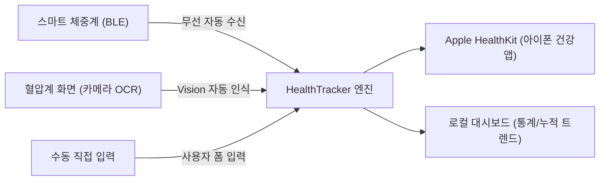

# 📋 프로젝트 기획안: HealthTracker (건강 데이터 통합 관리 앱)

> **문서 버전:** v1.0.0  
> **작성일:** 2026-11-06  
> **상태:** 초안 (Draft)  
> **참조 플레이북:** [03_dev_plan.md (Obsidian ai_playbooks)](file:///Users/moses/Documents/Obsidian%20Vault/ai_playbooks/03_dev_plan.md)

---

## 1. 프로젝트 개요 (Overview)

### 1.1 배경 및 목적
현대인은 다양한 건강 측정 기기(체중계, 혈압계 등)를 사용하지만, 각 기기 제조사마다 앱이 파편화되어 있거나 수기 기록의 번거로움으로 인해 지속적인 건강 지표 관리가 어렵습니다.
특히 아이폰 사용자에게는 **Apple Health(HealthKit)**라는 강력한 표준 저장소가 있으나, 비연동 기기의 데이터를 손쉽게 입력하고 체계적으로 누적·분석하는 데는 한계가 있습니다.

**HealthTracker**는:
1. **스마트 체중계**의 BLE 데이터를 자동으로 수신하고,
2. **혈압계**의 액정 화면을 카메라(Vision OCR)로 촬영하거나 간편 입력하여,
3. 모든 데이터를 **아이폰 건강(Apple HealthKit)**과 매끄럽게 동기화하고 종합 건강 지표의 누적 추이를 직관적으로 제공하는 것을 목적으로 합니다.

### 1.2 핵심 타겟 사용자
* 혈압 및 체중을 매일 측정하고 기록해야 하는 만성질환 관리자(고혈압, 대사증후군 등) 및 시니어
* 다이어트, 바디프로필, 린매스업 등을 위해 체성분과 체중을 정밀 추적하는 피트니스 사용자
* 여러 측정 기기를 쓰지만 데이터는 Apple 건강 앱 하나로 깔끔하게 모으고 싶은 아이폰 사용자

---

## 2. 핵심 기능 요구사항 (Functional Requirements)

### 2.1 [기능 1] 스마트 체중계 연동 및 데이터 처리
* **BLE(Bluetooth Low Energy) 통신:**
  * 표준 블루투스 체중 프로필(Weight Scale Service - `0x181D`) 및 상용 스마트 체중계(Custom Advertising 패킷) 데이터 스캔/페어링
* **데이터 파싱 및 정규화:**
  * 필수 항목: 체중(kg)
  * 지원 기기 확장 항목: 체지방률(%), 골격근량, 체수분, BMI
* **HealthKit 동기화:**
  * `HKQuantityTypeIdentifierBodyMass` (체중)
  * `HKQuantityTypeIdentifierBodyFatPercentage` (체지방률)
  * `HKQuantityTypeIdentifierBodyMassIndex` (BMI)

### 2.2 [기능 2] 혈압 측정 기록 (카메라 OCR + 수동 입력 하이브리드)
* **카메라 OCR (Vision 기반 인식):**
  * 스마트폰 카메라로 혈압계 7-Segment 또는 LCD 디스플레이 촬영
  * On-Device Vision 프레임워크(Apple Vision Text Recognition)를 활용하여 숫자 추출
  * 혈압계 디스플레이의 표준 3요소 자동 분류 알고리즘:
    1. **수축기 혈압(SYS)**: 보통 최상단 또는 가장 큰 숫자 (80~220 mmHg)
    2. **이완기 혈압(DIA)**: 두 번째 숫자 (50~130 mmHg)
    3. **맥박수(PULSE)**: 하단 숫자 (40~180 bpm)
* **인식 결과 확인 및 수정 UI:**
  * 촬영 즉시 박스 표시 및 인식된 수치 미리보기 제공
  * 오인식 대비 간편 터치 키패드 수정 지원
* **수동 직접 입력 모드:**
  * 카메라 미사용 사용자를 위한 대형 숫자 다이얼/키패드 입력 화면
* **HealthKit 동기화:**
  * `HKCorrelationTypeIdentifierBloodPressure` (수축기/이완기)
  * `HKQuantityTypeIdentifierHeartRate` (맥박수)

### 2.3 [기능 3] 종합 건강 데이터 누적 관리 및 시각화
* **통합 대시보드:**
  * 최근 측정치 카드 (오늘의 체중, 오늘의 혈압/맥박)
  * 건강 상태 요약 뱃지 (정상, 주의, 고혈압 전단계, 1기/2기 고혈압 등 가이드라인 기준 판정)
* **트렌드 & 시각화 차트:**
  * 일간 / 주간 / 월간 / 연간 추이 꺾은선 그래프
  * 체중 변동 폭(최고/최저/평균) 및 혈압 변동성(수축기-이완기 갭) 시각화
* **리포트 내보내기:**
  * 진료/상담용 PDF 리포트 생성 및 공유 기능 (기간별 혈압/체중 일지)

---

## 3. 비기능적 요구사항 (Non-Functional Requirements)

1. **개인정보 보호 및 보안 (Data Privacy First):**
   * 모든 측정 데이터는 기기 로컬 및 Apple HealthKit에만 안전하게 보관 (별도 외부 서버로 전송하지 않아 회원가입 없는 순수 온디바이스 앱 지향)
   * 생체인식(Face ID / Touch ID) 잠금 기능 지원
2. **접근성 및 사용성 (Accessibility):**
   * 시니어 및 고령층 사용자를 위한 고대비 UI, 큰 글씨 모드(Dynamic Type) 지원
   * 카메라 촬영 시 명확한 가이드 오버레이(혈압계 화면 정렬 가이드) 제공
3. **오프라인 대응:**
   * 네트워크 연결 없이도 100% 동작 (BLE, Vision OCR, HealthKit 모두 기기 로컬에서 처리)

---

## 4. 권장 기술 스택 (Tech Stack)

* **플랫폼:** iOS (iOS 17.0+)
* **언어 및 UI:** Swift, SwiftUI
* **핵심 프레임워크:**
  * **HealthKit:** 건강 데이터 읽기/쓰기 및 동기화
  * **CoreBluetooth:** BLE 스마트 체중계 스캔 및 패킷 수신
  * **Vision & AVFoundation:** 카메라 화면 캡처 및 LCD 숫자 OCR
  * **SwiftData (또는 CoreData):** 로컬 기록 캐싱, 기기 페어링 설정 저장
  * **Swift Charts:** 주간/월간 바이탈 사인 추이 그래프

---

## 5. 단계별 개발 로드맵 (Milestones)

| 단계 | 마일스톤 | 주요 산출물 및 목표 |
| :---: | :--- | :--- |
| **Phase 1** | **기반 구축 & HealthKit 연동** | - 앱 프로젝트 세팅 및 HealthKit 권한 획득 Flow - 수동 입력(체중, 혈압) 구현 및 HealthKit 저장 검증 |
| **Phase 2** | **혈압계 카메라 OCR 구현** | - AVFoundation 카메라 뷰 + Vision 프레임워크 연동 - 혈압계 LCD 숫자 파싱 알고리즘 및 컨펌 UI |
| **Phase 3** | **스마트 체중계 BLE 연동** | - CoreBluetooth 매니저 구현 - 표준 체중계 서비스 스캔 및 측정값 실시간 파싱 |
| **Phase 4** | **종합 대시보드 & 시각화** | - Swift Charts 기반 주간/월간 추이 뷰 - 건강 상태 기준표 적용 및 데이터 누적 통계 |
| **Phase 5** | **폴리싱 및 배포 준비** | - 진료용 PDF 내보내기 - Face ID 잠금, 고대비 시니어 모드 지원 |

---

## 6. 다음 결정 및 과제 (Open Questions)
1. 타겟 지원 체중계 모델: 표준 Bluetooth SIG 규격을 따르는 기기를 기본으로 할지, 샤오미(Mi Scale) 등 특정 대중적 제조사 프로토콜을 우선 역공학/지원할지 여부
2. 디자인 및 테마 방향성: 미니멀 애플 네이티브 스타일 vs 고령층 친화 대형 폰트 스타일

