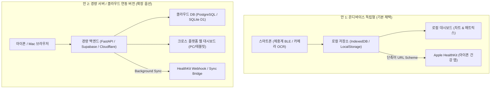

# 📋 프로젝트 기획안: HealthTracker (건강 데이터 통합 관리 앱)

> **문서 버전:** v1.4.0  
> **작성일:** 2026-11-10  
> **상태:** 기획 정식안 (밸런스랩 가상 장치 검증 체계 반영)  
> **참조 플레이북:** [03_dev_plan.md (Obsidian ai_playbooks)](file:///Users/moses/Documents/Obsidian%20Vault/ai_playbooks/03_dev_plan.md)  
> **연계 산출물:**
> - [앱 화면 구성안 (plan_health_tracker/ui_health_tracker.html)](file:///Users/moses/myfolder/Project/health_tracker/plan_health_tracker/ui_health_tracker.html) : 온디바이스 단일 파일 실행 웹앱
> - [가상장치 화면 구성안 (plan_health_tracker/ui_balanslab_virtual_device.html)](file:///Users/moses/myfolder/Project/health_tracker/plan_health_tracker/ui_balanslab_virtual_device.html) : 맥북 가상 체중계 테스트 어드민
> - [건강 지표 임상 표준 및 판정 기준서 (plan_health_tracker/ref_health_metric_standards.md)](file:///Users/moses/myfolder/Project/health_tracker/plan_health_tracker/ref_health_metric_standards.md) : 지표별 정의, 상태별 기준선(임계값), 상태 배지 연동 규격의 단일 진실 공급원(SSOT)
> - [개발 로그 (plan_health_tracker/devlog_health_tracker.md)](file:///Users/moses/myfolder/Project/health_tracker/plan_health_tracker/devlog_health_tracker.md) : 프로젝트 의사결정 및 진행 이력 기록

---

## 1. 프로젝트 개요 (Overview)

### 1.1 배경 및 문제 정의 (Pain Points)
체중과 혈압을 측정하여 꾸준히 건강 관리를 해오고 있으나, 기존 상용 앱 생태계의 한계로 인해 많은 불편이 발생함.
* **불필요한 광고 및 부가 기능(Bloatware):** `OKOK·국제판` 체중계 앱의 상시 배너 광고(Trip.com 등) 및 불필요한 위젯(단식, 물 마시기, 줄넘기 등)으로 핵심 지표 조회가 번잡함.
* **유료 결제 유도 압박:** `혈압 기록` 앱의 광고 제거 유효 기간 만료 임박 등 지속적인 인앱 결제 압박 발생.
* **앱 파편화에 따른 동선 낭비:** 매일 아침 `OKOK`, `혈압 기록`, `Apple 건강` 등 2~3개 앱을 번갈아 실행해야 하는 비효율성.
* **통합 시각화 부재:** 체중과 혈압은 심혈관 및 대사 건강의 핵심 상호 연관 지표이나, 두 수치를 한 화면에서 시계열로 비교·분석하는 단일 뷰가 부재함.

### 1.2 프로젝트 목표 (Goal)
광고 없는(Zero-Ad) 깔끔한 Apple 인터페이스 표준(Clean Minimal White & Slate) 환경에서, **스마트 체중계(BLE 자동 수신)**와 **혈압계(카메라 Vision OCR / 간편 수기 입력)** 데이터를 한곳에 모으고, **아이폰 건강 앱(Apple HealthKit)**과 연동하는 통합 건강 관리 체계 구축.

---

## 2. 시스템 아키텍처 비교 수립 (Two Architecture Options)

가볍고 독립적으로 동작하는 온디바이스 독립형(로컬) 방식을 기본 채택하고, 향후 다기기 확장이 가능한 경량 서버 방식을 대안으로 수립함.

### [안 1] 온디바이스 독립형 버전 (On-Device Standalone) — **기본 채택**
* **개요:** 외부 서버가 일절 불필요한 100% 로컬 독립형 단일 웹앱 아키텍처.
* **주요 특징:**
  * **서버 비용 0원, 트래픽 0:** 모든 데이터(1년 수백 KB 내외)를 아이폰 내부(IndexedDB)에 저장.
  * **보안 및 프라이버시 최상:** 민감한 개인 건강 데이터(체중, 체성분, 혈압)의 외부 네트워크 유출 위험 원천 차단.
  * **무료 구동 체계:**
    * Web BLE 지원 브라우저(`Bluefy`)에서 단일 HTML 실행하여 밸런스랩 체중계 BLE 데이터 직접 수신.
    * 측정 완료 즉시 Apple 공식 `단축어(Shortcuts)` URL 스킴(`shortcuts://run-shortcut?name=LogHealth&input=...`)을 호출하여 **별도 유료 개발자 등록이나 7일 재서명 없이 HealthKit에 직접 저장**.

### [안 2] 경량 서버 / 클라우드 연동 버전 (Cloud-Synced) — **확장 옵션**
* **개요:** 개인 Mac(홈서버) 또는 무료 티어 클라우드(Supabase/Cloudflare)를 활용한 동기화 버전.
* **주요 특징:**
  * **크로스 디바이스 지원:** 아이폰뿐만 아니라 Mac 모니터, 아이패드 등 대화면 브라우저에서 건강 대시보드 조회 가능.
  * **자동 원격 백업:** 기기 분실 또는 교체 시 데이터 자동 복구.
  * **고려 사항:** 초기 백엔드 배포 및 지속적인 네트워크 연결 관리 필요.

---

## 3. 핵심 기능 요구사항 (Functional Requirements)

### 3.1 스마트 체중계 (밸런스랩 BIA) 연동 & 생체분석 지표 일별 개별 보관
* **BLE 통신 규격:**
  * Bluetooth SIG 표준 체중계 서비스(`0x181D`) 및 밸런스랩/OKOK 커스텀 서비스(`0xFFF0`) 19바이트 BIA 패킷 파싱.
  * 수신 확인(ACK) 역전송 특성(`0xFFF2`)을 통한 가상 장치와의 실시간 양방향 핸드셰이크 지원.
* **사용자 기준 신체 프로필:**
  * 신장: `176 cm`
  * 나이: `47 세` (BMR 및 체성분 판정 기본 파라미터)
* **Zero-Touch 자동 잠금 (Weight Lock):**
  * 체중계에 올라선 후 수치가 안정화(Blink 정지)되면 자동으로 앱이 값을 캡처하고 단축어를 통한 HealthKit 전송 트리거.
* **BIA 생체분석 지표의 일자별(시계열) 개별 누적 보관 (체중계 BIA 실측 12대 지표 + 앱 프로필 2대 속성):**
  * 단순 체중 단일값 저장이 아닌, **체중계에서 실측 전송되는 12대 BIA 생체지표를 비율(%)과 절대 질량(kg)으로 각각 분리하여 일자별로 누적 보관**함 (신장·나이는 핸드폰 앱의 사용자 프로필 속성으로 결합 연산).
  * **일별 개별 보관 12대 측정 지표 (체중계 BIA 실측 전송):**
    1. **체중 (Body Weight, kg):** 소수점 둘째 자리 (예: `80.30 kg`)
    2. **체질량 지수 (BMI):** 신장(176cm) 대비 체중 비율 (예: `25.9`)
    3. **지방 (%) (Body Fat Rate):** 백분율 (예: `25.0%`)
    4. **체질 지방량 (kg) (Body Fat Mass):** 순수 지방 질량 (예: `20.1 kg`)
    5. **골격근 비율 (%) (Skeletal Muscle Rate):** 백분율 (예: `38.0%`)
    6. **골격근량 (kg) (Skeletal Muscle Mass):** 순수 골격근 질량 (예: `30.6 kg`)
    7. **근육 (%) (Muscle Rate):** 전체 근육 백분율 (예: `70.5%`)
    8. **근육량 (kg) (Muscle Mass):** 전체 근육 질량 (예: `56.6 kg`)
    9. **수분 (%) (Water Rate):** 체수분 백분율 (예: `52.9%`)
    10. **물의 무게 (kg) (Water Mass):** 체수분 질량 (예: `42.5 kg`)
    11. **내장지방 기록 (Visceral Fat Level):** 소수점 1자리 단계 (예: `14.5`)
    12. **기초대사량 (BMR, kcal/day):** 열량 단위 (예: `1651.0 kcal/day`)
    *(추가 확장 연동: 뼈 무게/골량, 단백질 비율)*
  * **앱 고유 사용자 프로필 (체중계가 아닌 스마트폰에서 관리 및 판정 결합):**
    * **신장 (Height):** 고정값 `176 cm`
    * **실제 나이 (Age):** 고정값 `47 세`
  * **지표별 기준 표준 연계 (SSOT):**
    * ※ 각 지표별 상세 의학적 정의, 상태별 기준선(임계값), 상태 평가 배지 연동 규격은 단독 참조 표준서인 [ref_health_metric_standards.md](file:///Users/moses/myfolder/Project/health_tracker/plan_health_tracker/ref_health_metric_standards.md)를 단일 진실 공급원(SSOT)으로 삼아 개별 항목별로 객관적 근거를 바탕으로 정밀 수립·관리함.
  * **보관 목적:** 체중 감량 시 단순 체중 변화뿐 아니라 "골격근 유지 여부" 및 "순수 체지방 감량 여부"를 일자별로 정밀 비교·분석.

### 3.2 혈압 기록 (위드웰 액정 Vision OCR + 간편 수기 입력)
* **시간대별 3단 슬롯 관리 (기존 측정 습관 유지):**
  * 🌅 **아침 (기상 직후):** 공복 및 안정 시 기준 혈압
  * ☀️ **점심 (오후):** 일상 활동 중 혈압
  * 🌙 **저녁 (취침 전):** 취침 전 안정 시 혈압
* **온디바이스 Vision OCR (위드웰 3단 LCD 디스플레이 촬영):**
  * 통신 기능이 없는 위드웰 팔뚝형 자동혈압계의 액정 화면을 스마트폰 카메라로 촬영.
  * 세로 3단 7-Segment 전자식 디지털 폰트를 온디바이스에서 즉시 파싱:
    1. **수축기 혈압 (SYS):** 상단 숫자 (예: `105 mmHg`)
    2. **이완기 혈압 (DIA):** 중간 숫자 (예: `83 mmHg`)
    3. **맥박수 (PULSE):** 하단 숫자 (예: `87 bpm`)
  * **사전 검증 팝업:** 카메라 오인식 방지를 위해 인식된 3개 수치를 모사 팝업창에 1차 표시 후 원터치 확인 저장.
* **수동 직접 입력 폼:**
  * 키패드를 통한 3개 수치(SYS / DIA / PULSE) 즉시 수기 입력 지원.

### 3.3 Apple HealthKit 직접 연동 (Shortcuts Bridge)
* Apple 단축어의 `건강 샘플 기록(Log Health Sample)` 액션과 연동하여 아래 항목 실시간 쓰기:
  * `체중 (Body Mass)`
  * `체지방률 (Body Fat Percentage)`
  * `체질량 지수 (BMI)`
  * `수축기 혈압 (Blood Pressure Systolic)`
  * `이완기 혈압 (Blood Pressure Diastolic)`
  * `심박수 / 맥박 (Heart Rate)`

### 3.4 317일간의 기존 OKOK 데이터 승계 (CSV Import)
* OKOK 앱의 `[데이터 출력]` 기능에서 내보낸 CSV/Excel 파일 파싱.
* 317일간의 과거 체중(kg) 및 골격근율/체지방률 히스토리를 로컬 저장소로 일괄 마이그레이션하여 과거 11개월간의 감량 추이 복원.

### 3.5 통합 데이터 시각화 & 매트릭스 상세 뷰
* **홈 화면 1-스크린 컴팩트 뷰포트 (Zero-Scroll Mobile Optimized):**
  * 불필요한 상단 날짜/요일 텍스트 제거하고 상단 브랜드 헤더와 메인 지표 카드로 즉시 진입.
  * 모바일 화면 하나에 체중 카드와 혈압 카드가 스크롤 없이 한눈에 들어오는 황금 비율 레이아웃.
* **체중 카드 인터페이스:**
  * **기준일 우측 상단 배치:** 우측 끝에 은은한 뱃지 형태로 표기 (예: `기준일: 11월 9일`).
  * **메인 체중 & 직전 대비:** 대형 폰트와 직전 측정일 대비 증감 배지 수평 배치 (예: `80.30 kg` `↓ -0.25 kg (직전 대비)`).
  * **30일 최고 / 최저 몸무게 1줄 요약:** 소수점 1자리까지 간결하게 표기 (예: `30일 최고 81.2kg · 최저 79.9kg`).
  * **최근 5회 체중 추이:** 간결한 미니 스파크라인 SVG 차트.
  * **액션 버튼:** `[체중 측정]` (BLE 연결), `[직접 수동 입력]` 2분할 버튼.
* **혈압 카드 인터페이스:**
  * **기준일 우측 상단 배치:** 우측 끝에 표기 (예: `기준일: 11월 9일`).
  * **수축기 / 이완기 / 맥박:** 직관적인 컬러 구분 수치 표기 (`105 / 83 mmHg`, `맥박 87 bpm`).
  * **최근 5회 혈압 추이:** 수축기(SYS) & 이완기(DIA) 2라인 스파크라인 차트.
* **[상세] 탭 건강 지표 매트릭스 & 상세 뷰:**
  * **좌측 지표 항목 고정(Sticky Column) & 4일 단위 가로 스와이프 매트릭스 테이블:**
    * 좌측 '지표 항목' 열은 `sticky left-0`으로 항상 고정되며, 탭 시 해당 지표의 상세 3단 뷰(`Metric Detail View`)로 즉시 이동.
    * 우측 날짜별 수치 영역은 초기 최신 4개 일자를 로드하며, 손가락으로 왼쪽으로 밀면(가로 스크롤) 과거 데이터를 4개 단위로 점진적 자동 추가 로드하여 방대한 시계열을 쾌적하게 무한 탐색.
    * 모바일 폭 효율화를 위해 혈압 지표는 단위를 생략하고 간결한 명칭(`수축기 혈압`, `이완기 혈압`)으로 정돈.
  * 항목 터치 시 진입하는 **항목별 상세 3단 뷰 (Metric Detail View)**:
    1. **지표 설명 및 기준 범위 (가이드 & 배지 연동):**
       * 단독 임상 참조 표준서인 [`ref_health_metric_standards.md`](file:///Users/moses/myfolder/Project/health_tracker/plan_health_tracker/ref_health_metric_standards.md)를 단일 진실 공급원(SSOT)으로 삼아, 각 지표 고유의 특성에 맞게 개별 수립된 의학적/생체 기준 범위 게이지 바 마커 및 상태 평가 배지 연동.
    2. **지표 추이 인터랙티브 차트 (Zero-Scroll 최적화 & 구간별 지연 탐색):**
       * 초기 진입 시 최근 6일치(직전 비교 5개 구간)를 모바일 뷰포트 폭에 맞추어 즉시 렌더링하고, 스와이프/네비게이션 시 과거 데이터를 점진적으로 불러오는 경량 렌더링 체계 적용.
    3. **전체 기록 수치 표 (History Table):**
       * 측정일시, 측정값, 직전 대비 증감, 출처를 역순(최신순)으로 정렬하여 표시.

### 3.6 밸런스랩 가상 장치 테스트 어드민 (BalansLab Virtual Device Admin)
* **목적:**
  * 물리 체중계 없이 맥북을 체중계 송신 장치(BLE Peripheral)로 구동하여 건강 측정 데이터를 생성·수정하고, 블루투스 발송 및 송수신 과정을 검증하는 테스트 전용 어드민 구축.
* **1) 발송 건강 데이터 항목 (체중계 BIA 실측 12대 지표 + 상단 프로필 배지):**
  * 물리 체중계가 실측·전송하는 순수 12대 생체 지표를 4열 × 3행의 균형 잡힌 독립 카드 그리드로 제공:
    1. **체중 (kg):** 기본값 `80.30 kg`
    2. **BMI:** 신장 176cm 대비 자동 연동 (`25.9`, 음영 읽기전용)
    3. **지방 (%):** 체지방률 (`25.0%`)
    4. **체질 지방량 (kg):** 순수 지방 질량 (`20.1 kg`, 음영 읽기전용)
    5. **골격근 비율 (%):** 골격근 백분율 (`38.0%`)
    6. **골격근량 (kg):** 골격근 절대 질량 (`30.6 kg`, 음영 읽기전용)
    7. **근육 (%):** 전체 근육 백분율 (`70.5%`)
    8. **근육량 (kg):** 전체 근육 질량 (`56.6 kg`, 음영 읽기전용)
    9. **수분 (%):** 체수분 백분율 (`52.9%`)
    10. **물의 무게 (kg):** 체수분 질량 (`42.5 kg`, 음영 읽기전용)
    11. **내장지방 기록:** 소수점 1자리 단계 (`14.5`)
    12. **기초대사량:** 열량 단위 (`1651.0 kcal/day`)
    *(추가 BIA 확장 연동: 뼈 무게/골량 kg, 단백질 %)*
  * **상단 헤더 기준 프로필 배지:**
    * 체중계 전송 항목이 아닌 핸드폰 앱 고유 속성인 `신장(176cm)`과 `나이(47세)`는 카드 그리드에서 분리하여 상단 헤더 우측의 `[기준 프로필: 176cm · 47세]` 배지로 단정하게 배치.
* **2) 데이터 생성 및 편집:**
  * **직접 수정:** 각 항목 수치를 인풋 필드에서 직접 입력 시 %에 따른 질량(kg) 및 BMI 실시간 자동 재계산.
  * **기본값 초기화 (80.30kg):** 실제 11/10 07:11 실측 데이터(80.30kg / 25.0% / 38.0% 등) 기준값으로 원클릭 초기화.
  * **랜덤 생성:** 사용자 체형(80kg 전후, 골격근 38%) 기준 현실적 수치 자동 생성.
* **3) 발송 동작 제어 & 실시간 상태 알림:**
  * **BLE 패킷 규격:** 상용 밸런스랩 1:1 대응 `OKOK 19바이트 BIA 풀 프레임` 내부 자동 고정 (불필요한 선택 UI 제거).
  * **발송 (체중계 올라섬):** 누르면 중단할 때까지 블루투스 신호를 지속 브로드캐스팅(송출)하여 핸드폰에서 스캔 및 수신할 수 있도록 유지.
  * **중단 (체중계 내려옴):** 신호 송출을 멈추고 대기 상태로 전환.
  * **상태 알림 및 수신 확인 배너:**
    * 개발자용 덤프 로그창 제거, 3단계 직관적 상태 카드(대기 중 / 블루투스 신호 발송 중 / 핸드폰 수신 완료)로 간결화.
    * 핸드폰(Bluefy/HealthTracker)에서 수신 확인(ACK) 감지 시 자동으로 `🎉 핸드폰에서 수신을 완료했습니다!` 축하 배너 노출 및 송출 자동 종료.
* **4) 화면 구성안:**
  * 순수 테스트 어드민 콘솔 [`ui_balanslab_virtual_device.html`](file:///Users/moses/myfolder/Project/health_tracker/plan_health_tracker/ui_balanslab_virtual_device.html) 연계.

---

## 4. UI/UX 디자인 시스템 가이드 (Clean Minimal White & Slate)

* **Apple HIG 표준 라이트 모드 (Clean Minimal White & Slate):**
  * 기본 배경: `#F8FAFC` (Slate-50) 및 순백색 `#FFFFFF`
  * 카드 서피스: `#FFFFFF` (순백색 바탕에 `border-slate-200` 및 섬세한 소프트 섀도우 `shadow-sm`)
  * 텍스트 타이포그래피: 주 텍스트 `#0F172A` (Slate-900), 보조 설명 `#64748B` (Slate-500)
  * 포인트 건강 컬러:
    * 수축기 / 심혈관: `#E11D48` (Rose-600)
    * 이완기 / 체중계: `#0284C7` (Sky-600) / `#2563EB` (Blue-600)
    * 감소 / 골격근 정상: `#059669` (Emerald-600)
    * 시간대 / 연속 측정 배지: `#D97706` (Amber-600)
* **Zero-Ad & Zero-Clutter 원칙:**
  * 배너 광고 및 불필요한 위젯 일절 배제.
  * 하단 3대 탭 바(`홈`, `상세`, `설정`) 중심의 간결하고 집중도 높은 인터페이스 구성.

---

## 5. 단계별 개발 로드맵 (Milestones)

| 단계 | 목표 | 주요 산출물 | 상태 |
| :--- | :--- | :--- | :---: |
| **Phase 1** | 기획 및 인터랙티브 UI 확정 | `docs/01_plan_health_tracker.md`, `ui_health_tracker.html` | **완료** |
| **Phase 2** | 데이터 구조 & 로컬 DB 엔진 구축 | 8대 생체지표 IndexedDB 스키마, OKOK 317일 파서/시드, 캘린더/차트 동적 렌더러 | **완료** |
| **Phase 3** | Apple HealthKit 단축어 규격 구축 | Shortcuts JSON 스펙 정의, 원터치 URL Scheme 연동 브릿지 | **완료** |
| **Phase 4** | Web BLE 체중계 & 카메라 OCR 모듈 결합 | Bluefy Web Bluetooth 통신 스크립트, 온디바이스 카메라 실시간 뷰파인더 & OCR 엔진 | **완료** |
| **Phase 5** | 밸런스랩 가상 장치 구축 및 실기기 검증 | `ui_balanslab_virtual_device.html`, `scale_sim` (BLE Peripheral) | **진행 중** |
