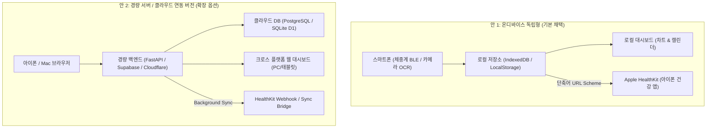

# 📋 프로젝트 기획안: HealthTracker (건강 데이터 통합 관리 앱)

> **문서 버전:** v1.3.0  
> **작성일:** 2026-11-06  
> **상태:** 기획 정식안 (문체 간결화 및 생체지표 일별 보관 규격 반영)  
> **참조 플레이북:** [03_dev_plan.md (Obsidian ai_playbooks)](file:///Users/moses/Documents/Obsidian%20Vault/ai_playbooks/03_dev_plan.md)  
> **연계 산출물:** [화면 구성안 (ui_health_tracker.html)](./ui_health_tracker.html)

---

## 1. 프로젝트 개요 (Overview)

### 1.1 배경 및 문제 정의 (Pain Points)
체중과 혈압을 측정하여 꾸준히 건강 관리를 해오고 있으나, 기존 상용 앱 생태계의 한계로 인해 많은 불편이 발생함.
* **불필요한 광고 및 부가 기능(Bloatware):** `OKOK·국제판` 체중계 앱의 상시 배너 광고(Trip.com 등) 및 불필요한 위젯(단식, 물 마시기, 줄넘기 등)으로 핵심 지표 조회가 번잡함.
* **유료 결제 유도 압박:** `혈압 기록` 앱의 광고 제거 유효 기간(19일) 만료 임박 등 지속적인 인앱 결제 압박 발생.
* **앱 파편화에 따른 동선 낭비:** 매일 아침 `OKOK`, `혈압 기록`, `Apple 건강` 등 2~3개 앱을 번갈아 실행해야 하는 비효율성.
* **통합 시각화 부재:** 체중과 혈압은 심혈관 및 대사 건강의 핵심 상호 연관 지표이나, 두 수치를 한 화면에서 시계열로 비교·분석하는 단일 뷰가 부재함.

### 1.2 프로젝트 목표 (Goal)
광고 없는(Zero-Ad) 깔끔한 Apple 인터페이스 표준(Clean Minimal White & Slate) 환경에서, **스마트 체중계(BLE 자동 수신)**와 **혈압계(카메라 Vision OCR / 간편 수기 입력)** 데이터를 한곳에 모으고, **아이폰 건강 앱(Apple HealthKit)**과 연동하는 통합 건강 관리 체계 구축.

---

## 2. 시스템 아키텍처 비교 수립 (Two Architecture Options)

가볍고 독립적으로 동작하는 온디바이스 독립형(로컬) 방식을 기본 채택하고, 향후 다기기 확장이 가능한 경량 서버 방식을 대안으로 수립함.

### [안 1] 온디바이스 독립형 버전 (On-Device Standalone) — **기본 채택**
* **개요:** 외부 서버가 일절 불필요한 100% 로컬 독립형 단일 웹앱 아키텍처.
* **주요 특징:**
  * **서버 비용 0원, 트래픽 0:** 모든 데이터(1년 수백 KB 내외)를 아이폰 내부(IndexedDB)에 저장.
  * **보안 및 프라이버시 최상:** 민감한 개인 건강 데이터(체중, 체성분, 혈압)의 외부 네트워크 유출 위험 원천 차단.
  * **무료 구동 체계:**
    * Web BLE 지원 브라우저(`Bluefy`)에서 단일 HTML 실행하여 밸런스랩 체중계 BLE 데이터 직접 수신.
    * 측정 완료 즉시 Apple 공식 `단축어(Shortcuts)` URL 스킴(`shortcuts://run-shortcut?name=LogHealth&input=...`)을 호출하여 **별도 유료 개발자 등록이나 7일 재서명 없이 HealthKit에 직접 저장**.

### [안 2] 경량 서버 / 클라우드 연동 버전 (Cloud-Synced) — **확장 옵션**
* **개요:** 개인 Mac(홈서버) 또는 무료 티어 클라우드(Supabase/Cloudflare)를 활용한 동기화 버전.
* **주요 특징:**
  * **크로스 디바이스 지원:** 아이폰뿐만 아니라 Mac 모니터, 아이패드 등 대화면 브라우저에서 건강 대시보드 조회 가능.
  * **자동 원격 백업:** 기기 분실 또는 교체 시 데이터 자동 복구.
  * **고려 사항:** 초기 백엔드 배포 및 지속적인 네트워크 연결 관리 필요.

---

## 3. 핵심 기능 요구사항 (Functional Requirements)

### 3.1 스마트 체중계 (밸런스랩 BIA) 연동 & 생체분석 지표 일별 개별 보관
* **BLE 통신 규격:**
  * Bluetooth SIG 표준 체중계 서비스(`0x181D`) 및 밸런스랩 제조사 패킷 파싱.
* **Zero-Touch 자동 잠금 (Weight Lock):**
  * 체중계에 올라선 후 수치가 안정화(Blink 정지)되면 자동으로 앱이 값을 캡처하고 단축어를 통한 HealthKit 전송 트리거.
* **BIA 생체분석 지표의 일자별(시계열) 개별 누적 보관:**
  * 단순 체중 단일값 저장이 아닌, **측정 시 생성되는 모든 BIA 생체지표를 일자별로 각각 누적 보관**함.
  * **일별 개별 보관 지표 항목:**
    1. **체중 (Body Weight):** 소수점 둘째 자리 (예: `80.80 kg`)
    2. **체지방률 (Body Fat Percentage):** 백분율 (예: `25.2%`)
    3. **골격근율 (Skeletal Muscle Percentage):** 백분율 (예: `37.9%`)
    4. **골격근량 (Skeletal Muscle Mass):** 절대 질량 (kg)
    5. **체질량 지수 (BMI):** 신장 대비 체중 비율 (예: `26.1`)
    6. **내장지방 레벨 (Visceral Fat Level):** 단계 수치 (예: `Lv 8`)
    7. **체수분율 (Body Water Percentage):** 백분율 (%)
    8. **기초대사량 (BMR):** 열량 (kcal)
  * **보관 목적:** 체중 감량 시 단순 체중 변화뿐 아니라 "골격근 유지 여부" 및 "순수 체지방 감량 여부"를 일자별로 정밀 비교·분석.

### 3.2 혈압 기록 (위드웰 액정 Vision OCR + 간편 수기 입력)
* **시간대별 3단 슬롯 분리 관리 (기존 측정 습관 유지):**
  * 🌅 **아침 (기상 직후):** 공복 및 안정 시 기준 혈압
  * ☀️ **점심 (오후):** 일상 활동 중 혈압
  * 🌙 **저녁 (취침 전):** 취침 전 안정 시 혈압
* **온디바이스 Vision OCR (위드웰 3단 LCD 디스플레이 촬영):**
  * 전자 통신 기능이 없는 위드웰 팔뚝형 자동혈압계의 액정 화면을 스마트폰 카메라로 촬영.
  * 세로 3단 7-Segment 전자식 디지털 폰트를 온디바이스에서 즉시 파싱:
    1. **수축기 혈압 (SYS):** 상단 숫자 (예: `105 mmHg`)
    2. **이완기 혈압 (DIA):** 중간 숫자 (예: `83 mmHg`)
    3. **맥박수 (PULSE):** 하단 숫자 (예: `87 bpm`)
  * **사전 검증 팝업:** 카메라 오인식 방지를 위해 인식된 3개 수치를 실물 LCD 모사 팝업창에 1차 표시 후 원터치 확인 저장.
* **수동 직접 입력 폼:**
  * 키패드를 통한 3개 수치(SYS / DIA / PULSE) 즉시 수기 입력 지원.

### 3.3 Apple HealthKit 직접 연동 (Shortcuts Bridge)
* Apple 단축어의 `건강 샘플 기록(Log Health Sample)` 액션과 연동하여 아래 항목 실시간 쓰기:
  * `체중 (Body Mass)`
  * `체지방률 (Body Fat Percentage)`
  * `체질량 지수 (BMI)`
  * `수축기 혈압 (Blood Pressure Systolic)`
  * `이완기 혈압 (Blood Pressure Diastolic)`
  * `심박수 / 맥박 (Heart Rate)`

### 3.4 317일간의 기존 OKOK 데이터 승계 (CSV Import)
* OKOK 앱의 `[데이터 출력]` 기능에서 내보낸 CSV/Excel 파일 파싱.
* 317일간의 과거 체중(kg) 및 골격근율/체지방률 히스토리를 로컬 저장소로 일괄 마이그레이션하여 과거 11개월간의 감량 추이 복원.

### 3.5 통합 데이터 시각화 & 캘린더
* **통합 듀얼 라인 혈압 차트:**
  * 동일 차트 내 수축기(SYS, 로즈 레드)와 이완기(DIA, 스카이 블루) 라인을 동시에 렌더링하여 고혈압/정상 범위 추이를 직관적으로 식별.
* **월간 통합 캘린더 (OKOK 스타일 승계):**
  * 날짜 셀 안에 당일 체중 및 혈압 수치 직접 인쇄.
  * **전일 대비 증감 컬러 코딩:** 체중 감소 시 **녹색(Green)**, 증가 시 **빨간색(Red)** 배지 부여.

---

## 4. UI/UX 디자인 시스템 가이드 (Clean Minimal White & Slate)

* **Apple HIG 표준 라이트 모드 (Clean Minimal White & Slate):**
  * 기본 배경: `#F8FAFC` (Slate-50) 및 순백색 `#FFFFFF`
  * 카드 서피스: `#FFFFFF` (순백색 바탕에 `border-slate-200` 및 섬세한 소프트 섀도우 `shadow-sm`)
  * 텍스트 타이포그래피: 주 텍스트 `#0F172A` (Slate-900), 보조 설명 `#64748B` (Slate-500)
  * 포인트 건강 컬러:
    * 수축기 / 심혈관: `#E11D48` (Rose-600)
    * 이완기 / 체중계: `#0284C7` (Sky-600) / `#2563EB` (Blue-600)
    * 감소 / 골격근 정상: `#059669` (Emerald-600)
    * 시간대 / 연속 측정 배지: `#D97706` (Amber-600)
* **Zero-Ad & Zero-Clutter 원칙:**
  * 배너 광고 및 불필요한 위젯 일절 배제.
  * 한 손 조작(Thumb-Zone)에 맞춘 하단 5대 탭 바(`요약`, `체중계`, `+빠른입력`, `혈압`, `추이`) 중심 인터페이스 구성.

---

## 5. 단계별 개발 로드맵 (Milestones)

| 단계 | 목표 | 주요 산출물 | 상태 |
| :--- | :--- | :--- | :---: |
| **Phase 1** | 기획 및 인터랙티브 UI 확정 | `plan_health_tracker.md`, `ui_health_tracker.html` | **완료** |
| **Phase 2** | 데이터 구조 & 로컬 DB 엔진 구축 | 8대 생체지표 IndexedDB 스키마, OKOK 317일 파서/시드, 캘린더/차트 동적 렌더러 | **완료** |
| **Phase 3** | Apple HealthKit 단축어 규격 구축 | Shortcuts JSON 스펙 정의, 원터치 URL Scheme 연동 브릿지 | **완료** |
| **Phase 4** | Web BLE 체중계 & 카메라 OCR 모듈 결합 | Bluefy Web Bluetooth 통신 스크립트, 온디바이스 카메라 실시간 뷰파인더 & OCR 엔진 | **완료** |
